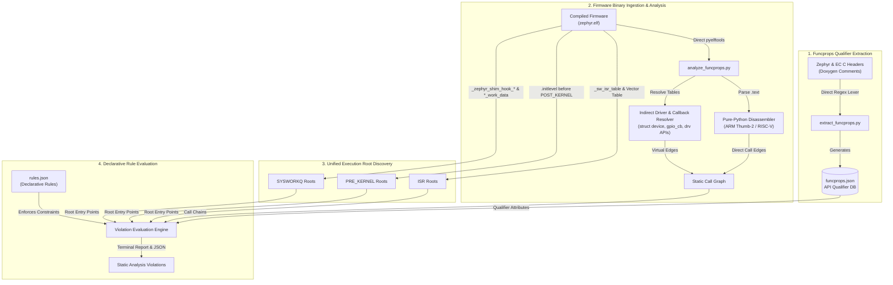

# Zephyr & ChromeOS EC Static Analysis Suite (`funcprops`)

This utility directory contains static analysis tools designed to extract Zephyr API terminology qualifiers (`@isr_ok`, `@sleep`, `@reschedule`, `@no_wait`, `@pre_kernel_ok`, `@async`, `@supervisor`) from Doxygen headers and enforce context safety rules across compiled ChromeOS EC Zephyr ELF binaries and source trees.

The entire suite operates deterministically with **zero tool or parser fallbacks**:
* **Direct `pyelftools`**: Extracts symbols, section headers, and section payload data directly with zero external tool dependencies or mini-ELF header fallbacks.
* **Pure-Python Instruction Decoders**: Disassembles ARM Thumb-2 and RISC-V branch and call instructions directly from `.text` without relying on `llvm-objdump` or subprocess invocations.
* **Deterministic Regex Lexer**: Parses Doxygen qualifiers and function declarations directly from C headers without Doxygen XML intermediate generation.
* **Ground-Truth Linker Metadata**: Discovers root execution entry points strictly from `.initlevel` entries before `__init_POST_KERNEL_start`, `_sw_isr_table`, `_zephyr_shim_hook_*_list_start .. _end`, and `*_work_data`.

---

## 1. Architecture



```text
 +-------------------------------------------------------------------------+
 |                      1. Qualifier Extraction Pipeline                   |
 +-------------------------------------------------------------------------+
   Zephyr & EC Headers (Doxygen)
              |
              v (Direct Regex Lexer)
      extract_funcprops.py  ------>  funcprops.json (Qualifier DB)
                                           |
 +-----------------------------------------|-------------------------------+
 |                      2. Firmware Analysis & Root Discovery              |
 +-----------------------------------------|-------------------------------+
   Compiled zephyr.elf                     |
      |                                    |
      +---> Symbol Table & Sections        |
      |        |                           |
      |        +--> ISR Roots (_sw_isr_table, vectors)
      |        +--> PRE_KERNEL Roots (.initlevel < POST_KERNEL)
      |        +--> SYSWORKQ Roots (_zephyr_shim_hook_*, *_work_data)
      |                                    |
      +---> Pure-Python Disassembler       |
      |        |                           |
      |        v                           |
      |     Static Call Graph              |
      |        ^                           |
      +---> Driver & Callback Resolver     |
               (gpio_cb, device APIs)      |
                                           |
 +-----------------------------------------|-------------------------------+
 |                      3. Declarative Rule Engine                         |
 +-----------------------------------------|-------------------------------+
                                           v
   Execution Roots + Call Graph + funcprops.json + rules.json
                                   |
                                   v
             analyze_funcprops.py Violation Evaluation Engine
                                   |
                                   v
                  Terminal & JSON Violation Reports
```

---

## 2. Declarative Rule Engine Architecture (`rules.json`)

All context violation rules are defined declaratively in [`rules.json`](rules.json). New static analysis checks can be added or modified without editing disassemblers or call-graph traversal code.

### Structure of a Rule Entry:
```json
{
  "rule_id": "SLEEP_IN_SYSWORKQ",
  "category": "Sysworkq Context Violation",
  "contexts": ["SYSWORKQ"],
  "prohibited_props": ["sleep"],
  "required_absent_props": ["no_wait"],
  "exemption_props": [],
  "path_matchers": [],
  "description": "Calling unconditional sleep or thread-blocking functions on k_sys_work_q causes starvation of critical system work and watchdog timeouts."
}
```

* **`rule_id`**: Identifier printed in reports.
* **`category`**: High-level classification (`ISR Context Violation`, `Pre-Kernel Violation`, `Sysworkq Context Violation`, `Critical Section Violation`).
* **`contexts`**: Target execution contexts (`ISR`, `PRE_KERNEL`, `SYSWORKQ`).
* **`prohibited_props`**: Qualifiers that trigger a violation when all are present on a callee (`sleep`, `reschedule`, etc.).
* **`required_absent_props`**: Qualifiers whose presence suppresses the rule (e.g., `no_wait` suppresses unconditional sleep rules; timeout-conditional primitives are audited on `SYSWORKQ` by default unless `--exclude-timeout-primitives` is specified).
* **`exemption_props`**: Qualifiers acting as safe pruning barriers (`isr_ok`, `pre_kernel_ok`).
* **`path_matchers`**: Substring keywords matched against the target callee (when `match_target` is `true` or `prohibited_props` is empty) or ancestor call path.
* **`match_target`**: When `true`, matches `path_matchers` strictly against the leaf target callee instead of any function along the call chain, avoiding cascading duplicates.
* **`requires_flag`**: Optional CLI flag required to activate the rule (e.g., `include_timeout_primitives`, enabled by default).
* **`description`**: Human-readable explanation of why the rule exists.

---

## 3. Quickstart Usage

Execute the tool commands directly from any workspace checkout:

```bash
cd src/platform/ec/util/funcprops

# Step 1: Extract Funcprops Database (Auto-detects EC and Zephyr headers relative to script)
python3 extract_funcprops.py

# Step 2: Run Unified Static Analysis on Compiled Firmware Binaries
python3 analyze_funcprops.py \
  ../../build/zephyr/domika/build-ro/zephyr/zephyr.elf \
  ../../build/zephyr/lapis/build-ro/zephyr/zephyr.elf \
  ../../build/zephyr/jubilant/build-ro/zephyr/zephyr.elf
```

### Context Filtering, Timeout Primitives, and JSON Output
```bash
python3 analyze_funcprops.py \
  --contexts isr,pre_kernel,sysworkq \
  --exclude-timeout-primitives \
  --allowlist allowed_fn1,allowed_fn2 \
  --warn-only \
  --json \
  /path/to/compiled/zephyr.elf
```

---

## 4. Running Unit Tests

To run the automated test suite:

```bash
python3 funcprops_test.py
```
