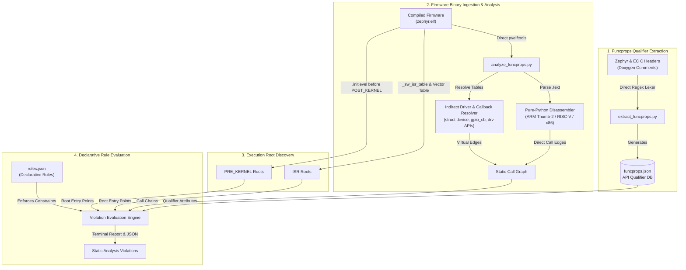

# Zephyr & ChromeOS EC `@funcprops` Static Analysis Tool (`util/funcprops`)

This directory contains static analysis tools that extract Zephyr API terminology qualifiers (`@isr_ok`, `@sleep`, `@reschedule`, `@no_wait`, `@pre_kernel_ok`, `@async`, `@supervisor`) from Doxygen headers and verify context compliance across compiled ChromeOS EC Zephyr ELF binaries (`ISR` and `PRE_KERNEL`).

The suite operates deterministically with zero external CLI dependencies:
* **Direct `pyelftools`**: Extracts symbols, section headers, and section payload data directly from compiled ELF binaries.
* **Pure-Python Instruction Decoders**: Disassembles ARM Thumb-2, RISC-V RV32IC, and x86 branch and call instructions directly from `.text` without relying on `llvm-objdump`.
* **Deterministic Regex Lexer**: Parses Doxygen qualifiers and function declarations directly from C headers.
* **Ground-Truth Linker Metadata**: Discovers root execution entry points from `_sw_isr_table`, fault/exception vectors, and `.initlevel` entries prior to `__init_POST_KERNEL_start`.

---

## 1. Architecture



---

## 2. Declarative Rule Engine (`rules.json`)

Context violation rules for `@funcprops` execution contexts are defined in [`rules.json`](rules.json):

```json
[
  {
    "rule_id": "SLEEP_IN_ISR",
    "category": "ISR Context Violation",
    "contexts": ["ISR"],
    "prohibited_props": ["sleep"],
    "required_absent_props": [],
    "exemption_props": ["isr_ok"],
    "path_matchers": [],
    "description": "Functions marked @sleep yield threads or block and cannot be called inside an interrupt handler unless wrapped by an @isr_ok function."
  },
  {
    "rule_id": "SLEEP_IN_PRE_KERNEL",
    "category": "Pre-Kernel Violation",
    "contexts": ["PRE_KERNEL"],
    "prohibited_props": ["sleep"],
    "required_absent_props": [],
    "exemption_props": ["pre_kernel_ok"],
    "path_matchers": [],
    "description": "Functions marked @sleep cannot be called during early PRE_KERNEL_1 / PRE_KERNEL_2 boot initialization hooks before thread scheduling is active unless marked @pre_kernel_ok."
  }
]
```

* **`rule_id`**: Rule identifier printed in reports (`SLEEP_IN_ISR`, `SLEEP_IN_PRE_KERNEL`).
* **`contexts`**: Target execution contexts (`ISR`, `PRE_KERNEL`).
* **`prohibited_props`**: Qualifiers that trigger a violation when present on a reachable callee (`sleep`).
* **`exemption_props`**: Qualifiers acting as context-safe boundary barriers (`isr_ok` in `ISR`, `pre_kernel_ok` in `PRE_KERNEL`). When a function carries the context's exemption qualifier (such as `cprints()` which checks `k_is_in_isr()` before acquiring a mutex), traversal stops at that boundary.

---

## 3. Usage

```bash
cd src/platform/ec/util/funcprops

# Step 1: Extract @funcprops database from EC and Zephyr headers
python3 extract_funcprops.py

# Step 2: Run static @funcprops analysis on compiled firmware ELFs
python3 analyze_funcprops.py \
  ../../build/zephyr/lapis/build-ro/zephyr/zephyr.elf \
  ../../build/zephyr/veluza/build-ro/zephyr/zephyr.elf
```

### CLI Options
```bash
python3 analyze_funcprops.py \
  --contexts isr,pre_kernel \
  --allowlist allowed_fn1,allowed_fn2 \
  --warn-only \
  --json \
  /path/to/compiled/zephyr.elf
```

---

## 4. System Workqueue Static Analyzer (`analyze_sysworkq.py` & `sysworkq_rules.json`)

[`analyze_sysworkq.py`](analyze_sysworkq.py) audits handlers that execute on Zephyr's system workqueue (`k_sys_work_q`), including `DECLARE_HOOK` routines (for hook types dispatched on `k_sys_work_q`), `DECLARE_DEFERRED` routines (`*_work_data`), and statically initialized `struct k_work` / `struct k_work_delayable` objects (`K_WORK_DEFINE` / `K_WORK_DELAYABLE_DEFINE`).

Violations are classified using [`sysworkq_rules.json`](sysworkq_rules.json):
* **`IO_IN_SYSWORKQ`**: Synchronous bus or flash I/O (`i2c_*`, `spi_*`, `crec_flash_physical_*`).
* **`SLEEP_IN_SYSWORKQ`**: Unconditional `@sleep` calls without a `@no_wait` path (`crec_usleep`, `k_sleep_ticks`, `task_wait_event*`, `k_work_flush*`, `k_work_cancel*_sync`, `k_thread_join`, `k_yield`, `k_condvar_wait`).
* **`NO_WAIT_IN_SYSWORKQ`**: `@sleep` + `@no_wait` synchronization primitives (`k_mutex_lock`, `k_sem_take`, `k_event_wait*`, `k_msgq_*`, `k_queue_get`, `k_poll`). Can be suppressed with `--exclude-no-wait`.

```bash
python3 analyze_sysworkq.py \
  --exclude-no-wait \
  --warn-only \
  ../../build/zephyr/lapis/build-ro/zephyr/zephyr.elf
```

---

## 5. Unit Tests

```bash
python3 funcprops_test.py
python3 sysworkq_test.py
```
